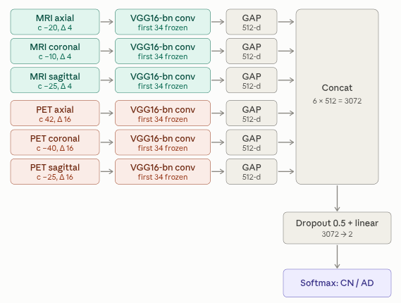

<h1 align='center'>Evidence Before Accuracy: An MRI–PET Fusion Network for Alzheimer's Disease Classification with Causal Regional Validation</h1>

<div align='center'>
    <a href='https://github.com/YOUR_GITHUB' target='_blank'>Author Name</a><sup>1</sup>&emsp;
</div>

<br>

<div align='center'>
    <a href='https://huggingface.co/saeed-5959/AD'></a>
    <a href='https://adni.loni.usc.edu/'></a>
    <a href='./LICENSE'></a>
</div>

## Abstract

Deep learning models for Alzheimer’s disease (AD)
classification routinely report near-perfect discrimination, yet
few are shown to rest on AD-relevant neurobiology rather than
on dataset artifacts, subject-level leakage, or non-brain image
content. We present a six-stream 2.5D fusion network combining
T1 MRI and FDG PET across axial, coronal, and sagittal
planes, trained on a strictly subject-disjoint ADNI consists of
554 paired subjects. The fusion model reaches AUC 0.962,
accuracy 0.909, and F1 0.891, competitive with recent 3D CNN
and multimodal transformer systems at substantially lower cost.
We first quantify how much modality, plane and slice geometry
matter. A validation-only search over slice centres and neighbour
spacings moves AUC by 0.180 for MRI and 0.078 for PET,
selecting narrow spacing for MRI (∆ = 4 mm) and wide spacing
for PET (∆ = 16 mm), with the chosen coronal centres falling on
the hippocampal body and on the posterior cingulate/precuneus
respectively. The contribution, however, is the evidence layer built
around that number. Shortcut controls collapse the model to
AUC 0.622 (silhouette), 0.608 (exterior), and 0.500 (blank), and
a label-permutation null yields 0.456. Forward region-of-interest
(ROI) ablation shows that masking medial temporal cortex in
MRI and the posterior default-mode network (DMN) in PET
produces the largest shift in the AD logit, while area-matched
controls remain indistinguishable from that null. Reverse ROI
ablation shows that the medial temporal lobe alone retains 89.2%
of above-chance discrimination in MRI and the posterior DMN
alone retains 79.0% in PET, versus 31.6% or less for area-
matched and enlarged controls. A quantitative comparison of
four attribution methods shows occlusion sensitivity reaching 3.5-
5.0× enrichment inside a priori AD regions against 0.10-0.43×
in controls. Ablation and attribution independently establish a
biologically correct double dissociation: hippocampal evidence
is carried by MRI, posterior cingulate and precuneus evidence
by PET. We argue that control-anchored causal validation of
this kind should be a reporting standard, and that gradient-
based saliency alone is insufficient evidence of biological validity.
## Model Structure



Six independent VGG16-BN streams (MRI × {axial, coronal, sagittal} and PET × {axial, coronal, sagittal}), each taking a 3-slice stack as a `(3, 224, 224)` input. Each stream is reduced with `AdaptiveAvgPool2d(1)`, the six 512-d descriptors are concatenated into a 3072-d vector, passed through dropout (p = 0.5), and classified by a single linear layer.

| Component | Setting |
|---|---|
| Backbone | VGG16-BN (ImageNet-initialized) |
| Head | `AdaptiveAvgPool2d(1)` → concat(6 × 512) → Dropout(0.5) → Linear |
| MRI slice centers | axial −20, coronal −10, sagittal −25 (Δ = 4) |
| PET slice centers | axial 42, coronal −40, sagittal −25 (Δ = 16) |
| Normalization clip | (−3.0, 3.0) for both modalities |
| Input statistics | MEAN = 0.449, STD = 0.226 |

## Results

| Metric | Value |
|---|---|
| Test AUC (six-stream fusion) | 0.962 |
Cohort: 554 paired MRI+PET ADNI subjects (230 AD / 324 CN)

## ⚒️ Installation

### Environment

    Ubuntu 20 or 22, Python 3.10, CUDA-capable GPU

### Download the code

```bash
git clone https://github.com/saeed5959/AD
cd AD
```

### Install packages with `pip`

```bash
pip install -r requirements.txt
```

### Install preprocessing dependencies

```bash
# DICOM → NIfTI conversion
apt-get install dcm2niix

# skull stripping (recommended in an isolated venv — it pins its own numpy ABI)
python -m venv .hdbet && source .hdbet/bin/activate
pip install hd-bet
deactivate

# registration and N4 bias correction
pip install antspyx
```

### Download [pretrained weights](https://huggingface.co/saeed-5959/AD/blob/main/vgg16_mm_fusion_p0.0_pre_fold0.pt)

```shell
git lfs install
git clone https://huggingface.co/saeed-5959/AD models
```

## Data

The dataset is not redistributed here. Request access from [ADNI](https://adni.loni.usc.edu/) and download:

- **MRI:** T1-weighted
- **PET:** FDG

Keep only subjects with a paired MRI and PET session. A small anonymized sample for smoke-testing the pipeline is in `dataset_test/`.


## Preprocess

Run the preprocessing scripts in order. Each stage writes to its own directory so intermediate outputs stay inspectable.

```bash
python -m preprocess.final_prep_1_to_nifti          # DICOM → NIfTI (dcm2niix)
python -m preprocess.final_prep_2_n4                # N4 bias field correction
python -m preprocess.final_prep_3_extract_brain     # HD-BET skull stripping
python -m preprocess.final_prep_4_mat_pet_mri       # rigid PET → MRI coregistration
python -m preprocess.final_prep_5_mri_mni           # ANTs SyN: MRI → MNI (HCP 1mm)
python -m preprocess.final_prep_6_compose           # compose transforms, single resample
python -m preprocess.final_prep_7_suvr_zscore       # PET SUVR (pons ref) + MRI z-score
python -m preprocess.final_prep_8_slice             # tri-planar slice extraction → .npy
python -m preprocess.final_prep_8_visualize         # QC montages
```

## Train

The single-modality models are trained first — the fusion model initializes its streams from their checkpoints.

```bash
# 1) single-modality streams
python -m train.train_vgg16_mri
python -m train.train_vgg16_pet

# 2) fusion, loading the MRI and PET checkpoints above
python -m train.train_vgg16_fusion
```

## Evaluate

Same order — evaluate the single-modality models first, then the fusion model against the fixed external test set.

```bash
python -m evaluation.evaluate_mri
python -m evaluation.evaluate_pet
python -m evaluation.evaluate_fusion
```


## Explainability

Three claims, each with its own script set. They are meant to be run in order, since Claim 3 assumes Claims 1 and 2 have already ruled out shortcut learning.

### Claim 1 — the model is not exploiting shortcuts

```bash
python -m explainability.claim1_remove_brain      # silhouette / exterior / blank controls
python -m explainability.claim1_permute_label     # label-permutation null training (N_PERM=20)
```

### Claim 2 — the evidence is spatially located where it should be

```bash
python -m explainability.claim2_saliency_map
python -m explainability.claim2_figures
```

### Claim 3 — AD-relevant regions are causally necessary

```bash
python -m explainability.claim3_roi_mask              # project Harvard-Oxford ROIs into 224×224 MNI slice space
python -m explainability.claim3_roi_ablation          # mask the ROI, keep everything else
python -m explainability.claim3_roi_reverse_ablation  # keep only the ROI, mask everything else
```

## 🙏🏻 Acknowledgements

Data used in this project were obtained from the [Alzheimer's Disease Neuroimaging Initiative (ADNI)](https://adni.loni.usc.edu/) database. ADNI investigators contributed to the design and implementation of ADNI and provided data but did not participate in the analysis or writing of this work.

## Citation

```bibtex
@article{YOURKEY2026evidence,
  title={Evidence Before Accuracy: An MRI--PET Fusion Network for Alzheimer's Disease Classification with Causal Regional Validation},
  author={Saeid Firouzi Daghigh and Saeed Ayat},
  journal={arXiv preprint arXiv:XXXX.XXXXX},
  year={2026}
}
```

## License

Released under the [MIT License](./LICENSE). ADNI data are governed separately by the ADNI Data Use Agreement.
